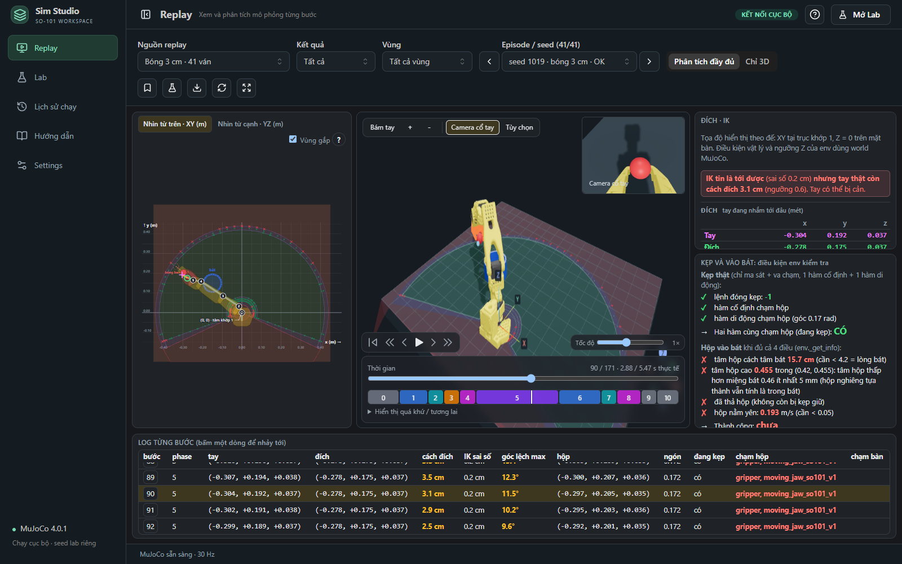
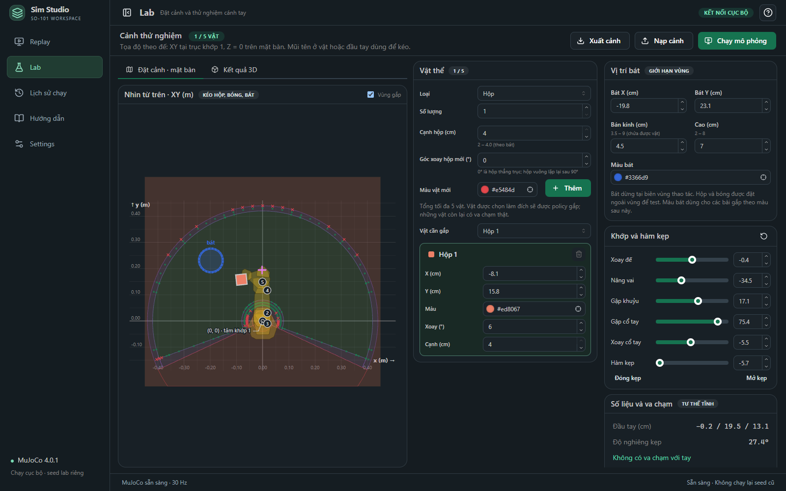

# SO-101 Sim Studio

Mô phỏng MuJoCo cánh tay **SO-101** gắp hộp / bóng bỏ vào bát, kèm **Sim Studio** để đặt cảnh, chạy thử và xem lại từng bước,
và policy viết tay dùng làm "chuyên gia" sinh dữ liệu cho bước huấn luyện AI (LeRobot) tiếp theo.

Fork từ [RajatDandekar/sim-engine](https://github.com/RajatDandekar/sim-engine) (bản bootcamp gốc, README gốc lưu ở
[`docs/upstream_README.md`](docs/upstream_README.md)). Nhánh làm việc: **`my-work`**.



## Sim Studio

```bash
git clone -b my-work https://github.com/tvhhai/sim-engine.git
cd sim-engine && pip install -e .[test]      # Python 3.12+, MuJoCo 4.0.1+
cd .. && python -m sim_engine.studio          # mở http://127.0.0.1:8765
```

| Màn hình | Làm gì |
|---|---|
| **Replay** | Xem từng bước mọi ván đã ghi: 3D (WebGL), camera cổ tay, nhìn từ trên / từ cạnh, timeline theo phase, bảng log, chẩn đoán kẹp và tiếp xúc (đỏ = chạm vật, tím = chạm bàn, hồng = chạm bát). Nút seed trước / sau; nhớ nguồn, seed, bước, tốc độ, bám tay |
| **Lab** | Đặt tới 5 hộp / bóng (2-4 cm, mặc định 4 cm), bát (cỡ, màu), tư thế tay; chạy mô phỏng thật và mở kết quả trong Replay |
| **Lịch sử chạy** | Các lần chạy Lab đã lưu: lọc, đánh dấu, ghi chú, so sánh, nạp lại cảnh |
| **Hướng dẫn** | Tài liệu tiếng Việt trong `docs/` |



## Policy viết tay

Mặc định `scripted_minjerk:ScriptedPolicyHybridMinJerk`: V1 (`policies/scripted_policy.py`, IK, phase 0-11) chạy trước với quỹ đạo
minimum-jerk (`policies/scripted_minjerk.py`: di chuyển mượt, thả thấp, hộp sát giới hạn khớp 1 thì kéo vòng cung); V1 bỏ cuộc mà vật còn
trong tầm thì V2 (`policies/scripted_v2.py`) gắp tiếp. Bóng dùng V1 gốc. Bản gốc: `--policy sim_engine.policies.scripted_hybrid:ScriptedPolicyHybrid`,
bộ seed replay của nó ở `results/goc/`.

1. Nâng tay từ home: khuỷu + cổ tay trước, vai sau (không quét trúng vật sát đế).
2. Tới trên vật ở độ cao tới được; hạ theo kế hoạch, roll khoá song song mặt hộp, né bát.
3. Kẹp. Bóng kẹp ngang tâm, hộp thấp hơn tâm 5 mm; khoảng lệch kẹp = 7 mm + nửa cỡ vật.
4. Nhấc. Vật sát đế: dời ra ngoài khi nhấc. Vật xa (r >= 40 cm): hộp kéo trượt vào rồi nhả, gắp lại; bóng nhấc 2 cm rồi mang trên không.
5. Mang tới bát, hạ, thả; rút lên, chờ vật nằm yên; rơi ra ngoài thì gắp lại (tối đa 2 lần); về home.

### Kết quả (774 seed: 0-199, seed cố định >= 200, 2000-2499)

| Bộ | Tất cả | r < 37 cm | r >= 37 cm (tay vươn gần hết) |
|---|---|---|---|
| Env chuẩn, hộp 3 cm | 767 (99,1 %) | 541/541 (100 %) | 226/233 (97,0 %) |
| Bóng 3 cm | 765 (98,8 %) | 539/541 | 226/233 |
| Hộp 4 cm | 729 (94,2 %) | 539/541 (99,6 %) | 190/233 (81,5 %) |
| Bóng 4 cm | 763 (98,6 %) | 537/541 | 226/233 |

760/774 seed nằm trong vùng xanh (r 8-42 cm, góc ±110°), 14 seed ở vùng hỗn hợp (r 4-8 cm hoặc 42-44 cm, hay sát giới hạn góc);
vùng hỗn hợp gắp được 12/14 ở cả bốn bộ. Gần như mọi seed hỏng nằm ở vòng ngoài r 37-42 cm, nơi trục kẹp nghiêng 47-66° so với
phương thẳng đứng nên hai hàm ôm vật yếu. Hộp 4 cm chịu thiệt nhất ở đó vì gần bằng độ mở tối đa của kẹp.
Theo cỡ hộp (45 seed): 2 cm 44, 3 cm 45, 3,5 cm 45, 4 cm 43, 4,5 cm 35, 5 cm 24, nên Lab giới hạn vật 2-4 cm.

## Công cụ

```bash
python -m sim_engine.tools.make_replay                   # replay chuẩn -> results/replay.json (Studio: "Bộ replay hiện tại")
python -m sim_engine.tools.object_replay --kind sphere   # replay bóng 4 cm: seed hỏng + seed theo dõi + đối chứng
python -m sim_engine.tools.select_seeds                  # chấm và chọn seed cho replay chuẩn
python -m sim_engine.tools.trace_episode --seed 2        # in timeline phase của một ván
python -m sim_engine.tools.watch_policy --seed 2         # xem trong cửa sổ MuJoCo
python -m sim_engine record -n 50                        # ghi demo HDF5 bằng policy viết tay
python -m pytest                                         # test Python (trong sim-engine/)
cd web/joint-lab && pnpm install && pnpm test && pnpm build   # giao diện Studio
```

Seed đã sửa không bị bỏ khỏi replay: `results/replay_pins.json` (replay chuẩn) và `results/object_pins.json` (bóng / hộp cỡ khác)
giữ danh sách seed theo dõi; seed hỏng mới tự được thêm vào.

## Thư mục

| Thư mục | Vai trò |
|---|---|
| `env.py`, `config.py`, `box_sampling.py`, `paths.py` | Env Gymnasium, hằng số, vị trí vật theo seed, đường dẫn |
| `assets/` | MJCF + mesh SO-101, bàn, hộp, bát |
| `policies/` | Policy viết tay (V1, V2, hybrid) và khung MLP / ACT / Diffusion / SmolVLA từ bản gốc |
| `tools/` | Replay, chấm seed, quét vùng gắp, xem từng bước |
| `workflows/` | Ghi demo, train, eval (`python -m sim_engine record / train / eval`) |
| `studio/` | Máy chủ Python của Sim Studio |
| `web/joint-lab/` | Mã nguồn giao diện Studio (React, Mantine, Three.js) |
| `static/studio/` | Bản build của `web/joint-lab` (sinh ra, không sửa tay) |
| `static/replay/` | Trang replay canvas, Studio nhúng lại |
| `app.py`, `ui/` | Giao diện OpenCV của bản gốc |
| `results/` | Dữ liệu sinh ra có commit (quét vùng, seed replay, seed theo dõi) |
| `docs/` | Hướng dẫn tiếng Việt, hình, README gốc |

## Hướng tiếp theo: policy học (AI)

Dùng policy viết tay làm chuyên gia: chỉ giữ ván thành công, ghi thành LeRobotDataset (camera trước + cổ tay, góc khớp, action), train
ACT rồi SmolVLA bằng LeRobot, đánh giá trên cùng bộ seed. Mã sẽ đặt ở `learning/`, dữ liệu ở `datasets/`, checkpoint ở `outputs/train/`
(hai thư mục sau không commit). Lộ trình, thư mục, gặp lỗi thì làm gì, từ điển: [`docs/so_tay_ai.md`](docs/so_tay_ai.md). Quy ước cho agent: [`AGENTS.md`](AGENTS.md).
