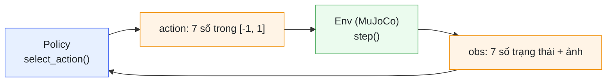
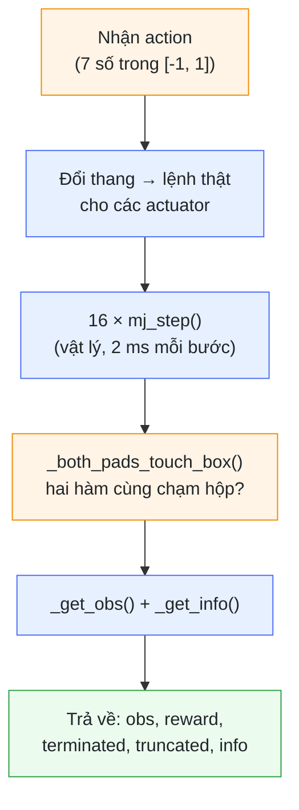
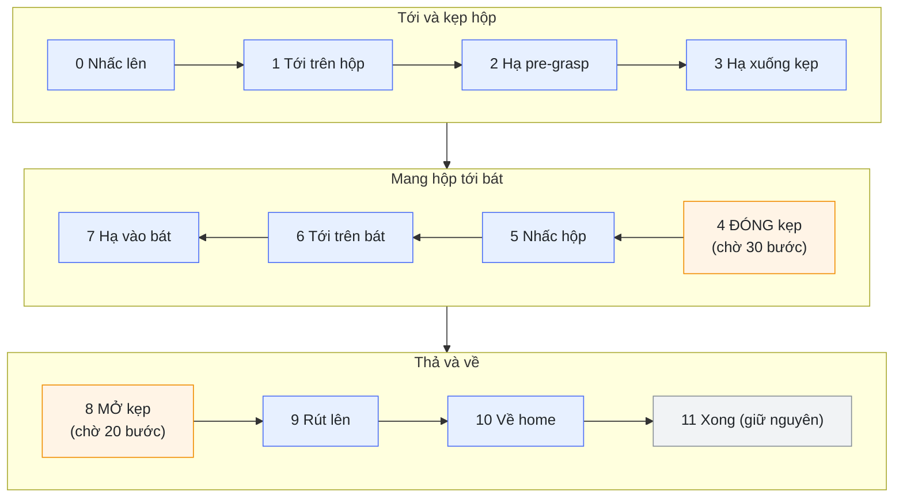
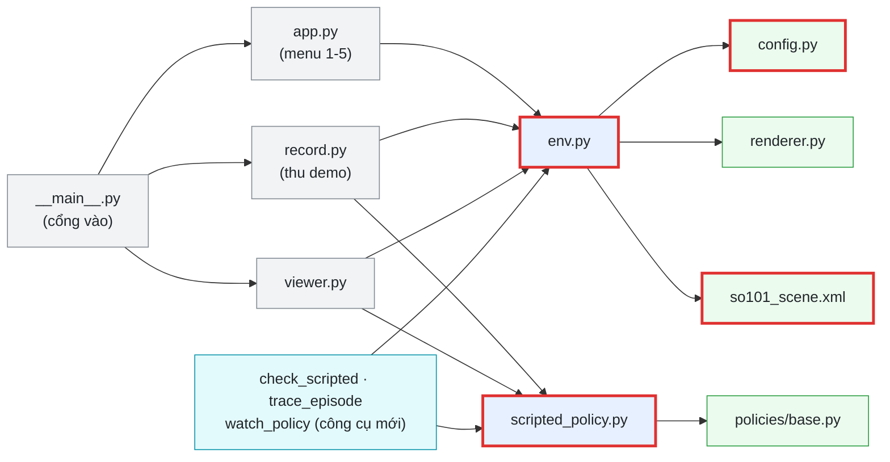

# Hiểu SimEngine trong 15 phút

Luồng hoạt động, file nào mở trước, và cách in log để tự quan sát — đi từ đơn giản đến phức tạp. Dành cho người mới với robot learning.

## 0. Hiểu bằng ví dụ: một trò chơi có 1 người chơi

Đọc phần này trước. Nếu phần này rõ rồi thì mọi phần sau chỉ là chi tiết.

Hãy tưởng tượng một **trò chơi điện tử**: màn hình có một cánh tay robot, một hộp đỏ và một cái bát xanh. Mục tiêu: **đưa hộp đỏ vào bát**.

| Trong trò chơi | Trong code | Nghĩa đơn giản |
| --- | --- | --- |
| Trò chơi (cả màn hình và luật chơi) | **env** (`env.py`) | Thế giới ảo: robot, hộp, bát, vật lý |
| Người chơi | **policy** (`scripted_policy.py`) | Bộ não quyết định bấm gì |
| Màn hình mà người chơi nhìn | **obs** (quan sát) | Góc các khớp robot + ảnh camera |
| Các nút bấm | **action** (hành động) | 7 con số: "xoay các khớp tới góc này, kẹp hay nhả" |
| Một lần nhìn rồi bấm | **step** (1 bước) | Khoảng 1/30 giây |
| Một ván chơi | **episode** | Tối đa 500 bước (~16 giây). Hộp vào bát = thắng |
| Số may rủi của ván | **seed** | Quyết định hộp nằm lệch chỗ nào. Cùng seed thì ván chơi lặp lại y hệt |

### Một ván chơi diễn ra thế này

1. Trò chơi đặt robot ở tư thế nghỉ, hộp nằm lệch một chút (tùy seed).
2. **Lặp lại 500 lần:** người chơi nhìn màn hình, bấm nút, trò chơi cập nhật.
3. Khi hộp vào bát, ván kết thúc: **thắng**. Hết 500 bước mà chưa xong: **thua**.

### Người chơi ở đây không phải AI

Hiện tại "người chơi" là một **kịch bản viết sẵn gồm 12 bước** (gọi là 12 **phase**): "đưa tay lên cao, đi tới trên hộp, hạ xuống, kẹp lại, nhấc lên, đi tới bát, thả ra, về chỗ cũ". Nó giống một **bot** chơi theo kịch bản. Bot này thắng 8 trên 10 ván thử.

### Vậy để làm gì?

Vì **bot ghi lại được các ván chơi thắng**. Hàng trăm ván ghi lại (gọi là **demo**) trở thành **sách giáo khoa** cho một model AI. AI xem sách đó rồi tự học cách chơi. Cuối khóa, AI thay thế bot, nhìn camera và nghe câu lệnh để điều khiển robot thật.

> **Tóm lại một câu:** bot viết tay tạo dữ liệu, AI học từ dữ liệu đó. Bạn đang ở bước làm quen với bot và trò chơi.

### Hai từ khó, nói bằng lời thường

| Từ | Nghĩa thường |
| --- | --- |
| **IK** (inverse kinematics) | "Muốn đầu tay tới điểm này thì mỗi khớp phải xoay bao nhiêu?" Giống như tính cách duỗi tay để chạm vào một cái cốc. |
| **Phase** | Một bước trong kịch bản của bot (ví dụ "hạ xuống kẹp"). Bot đi lần lượt từ phase 0 đến phase 11. |

## 1. Bức tranh lớn: cả khóa học là một chuỗi

Mục tiêu cuối: robot SO-101 làm theo câu lệnh. Con đường đi qua giả lập trước, robot thật sau. Viền đỏ là chỗ bạn đang đứng (tuần 1 đến 3).

*Chú thích màu: Giả lập / code · Dữ liệu · Train trên Colab · Mốc kiểm tra · Robot thật*

```mermaid
flowchart LR
  a["Sim MuJoCo<br/>(tuần 1-2)"]
  b["Policy viết tay<br/>(tuần 3)"]
  c["Thu 50 demo<br/>(tuần 4)"]
  d["Đẩy dataset lên<br/>Hugging Face (tuần 4)"]
  e["Train ACT / SmolVLA<br/>trên Colab (tuần 5-6)"]
  f["Checkpoint<br/>(model đã học)"]
  g["Chạy thử 50 lần<br/>Gate tuần 6"]
  h["Robot thật<br/>(tuần 7-12)"]
  a --> b
  b --> c
  c --> d
  d --> e
  e --> f
  f --> g
  g --> h
  classDef cloud fill:#f3f0ff,stroke:#7950f2,color:#212529
  classDef data fill:#fff4e6,stroke:#f08c00,color:#212529
  classDef ok fill:#ebfbee,stroke:#2f9e44,color:#212529
  classDef real fill:#fff0f6,stroke:#d6336c,color:#212529
  classDef sim fill:#e7f0ff,stroke:#4c6ef5,color:#212529
  class e,f cloud
  class c,d data
  class g ok
  class h real
  class a,b sim
  classDef hl stroke:#e03131,stroke-width:3px
  class a,b hl
```



*Theo Gantt của team (Sheet). Tuần 1 đến 3: sim + policy viết tay. Tuần 4: thu demo. Tuần 5 đến 6: train. Tuần 7 đến 12: robot thật.*

Điểm cốt lõi: **policy viết tay** chỉ là cách tạo demo tự động. Sau này nó được thay bằng một **model AI** học từ chính những demo đó. Phần còn lại (env, camera, dataset) giữ nguyên.

## 2. Vòng lặp cốt lõi: chỉ có 3 thứ

Mọi thứ trong robot learning đều xoay quanh vòng này. Hiểu nó là hiểu 80% repo.

*Chú thích màu: Policy (bộ não) · Env (sân tập, MuJoCo) · Dữ liệu đi qua*



*Mỗi vòng = 1 bước ≈ 1/30 giây. Một episode tối đa 500 bước (~16 giây).*

```python
obs, info = env.reset(seed=0)              # đặt sân tập về trạng thái đầu
for step in range(500):
    action = policy.select_action(obs)     # policy nhìn quan sát, quyết định hành động
    obs, reward, terminated, truncated, info = env.step(action)   # env thực hiện
    if terminated or truncated: break      # terminated = thành công, truncated = hết giờ
```

| Thứ | Là gì | Trong code |
| --- | --- | --- |
| **obs** (quan sát) | 7 số trạng thái + ảnh 2 camera | `env._get_obs()` |
| **action** (hành động) | 7 số trong [-1, 1]: góc đích 5 khớp + lệnh kẹp | `policy.select_action()` |
| **info** | Thông tin phụ cho bạn xem: vị trí hộp, bát, cờ thành công. *Policy AI không được dùng* | `env._get_info()` |

## 3. Bên trong một lần `env.step(action)`

**Phần nâng cao, lần đầu có thể bỏ qua.** Đây là file `env.py`, nơi "chấm điểm" và nhận biết "đang kẹp" nằm. Khi nào bạn muốn đọc code của `step` thì quay lại đây.

*Chú thích màu: Xử lý · Kiểm tra kẹp · Kết quả trả về*



1. **Đổi thang:** action [-1,1] đổi thành góc đích thật của từng khớp (theo khoảng trong XML).
2. **Kẹp:** action[5] đổi thành độ mở mỗi ngón (0,005 đến 0,04 m).
3. **Vật lý:** chạy 16 bước nhỏ 0,002 s (tổng 0,032 s, tức 31,25 Hz chứ không đúng 30). Hộp chỉ được giữ bằng **va chạm và ma sát thật** của hai hàm kẹp (mỗi hàm là nhiều khối lồi nhỏ `fixed_jaw_col_*`, `moving_jaw_col_*`). Không có đoạn code nào gán hộp vào tay.
4. **Kiểm tra kẹp:** `_both_pads_touch_box()` ghi `_grasped = True` khi cả hai hàm cùng đang chạm hộp. Đây chỉ là **thông tin** cho policy và cho việc chấm điểm, không điều khiển gì.
5. **Quan sát mới** (`_get_obs`) và thông tin (`_get_info`).
6. **Chấm điểm** (`_get_info`): thành công khi đủ 4 điều: tâm hộp trong lòng bát, tâm hộp thấp hơn miệng bát, hộp đã được **thả** (không còn bị kẹp) và hộp đã **nằm yên**. Hết 500 bước thì truncated.

## 4. Policy viết tay: 12 phase đi từ trái sang phải

File `policies/scripted_policy.py`. Mỗi phase có một điểm đích (x, y, z). IK tính góc khớp để tay tới điểm đó.

[Xem 12 phase của seed 1 trong Replay](studio:replay?seed=1)

*Chú thích màu: Di chuyển tay (dùng IK) · Đóng / mở kẹp (chờ số bước cố định) · Kết thúc*



*Đường đi rắn: hàng 1 từ trái sang phải, hàng 2 từ phải sang trái, hàng 3 từ trái sang phải.*

### Khi nào policy chuyển phase?

Trong `_move_toward`: chuyển khi tay cách đích dưới `threshold` (2 đến 2,5 cm) **hoặc** đã ở phase này quá 200 bước (timeout). Nếu thấy một phase kéo dài đúng 200 bước, tay không tới được đích.

<details>

<summary><b>Nâng cao: IK trong 4 dòng code (bấm để mở)</b></summary>

```python
error = target_pos - shadow_ee               # tay còn cách đích bao xa (vector 3D)
J = jacobian                                 # xoay mỗi khớp 1 chút thì tay dịch chuyển thế nào
dq = J.T @ solve(J @ J.T + lam**2 * I, error)  # giải: cần xoay mỗi khớp bao nhiêu
qpos += dq * 0.4                             # nhích 40%, lặp tối đa 40 lần
```

> **Lưu ý:** IK này chỉ điều khiển *vị trí* 3D của đầu tay, không điều khiển *hướng* của tay (ví dụ góc xoay cổ tay).

</details>

## 4b. Đích đến của tay đến từ đâu?

Ba câu hỏi: vị trí hộp và bát lấy ở đâu, tay đi tới đó bằng cách nào, và ai quyết định "gắp được rồi".

### 1. Vị trí hộp và bát: policy chỉ việc hỏi env

- Bát cố định ở `(-0.15, 0, 0.41)`, hộp mặc định ở `(0.15, 0, 0.44)` (file `config.py`, đơn vị mét).
- Mỗi lần `reset(seed)`, env cộng thêm độ lệch ngẫu nhiên ±3 cm vào x, y của hộp. Cùng seed thì cùng vị trí.
- Policy gọi `env.get_box_pos()` và `env.get_bowl_pos()`: đọc thẳng từ bộ mô phỏng, không cần camera.

> **Đây là "gian lận" có chủ ý.** Trong thực tế robot không được cho sẵn tọa độ hộp. Mục 4b.5 bên dưới giải thích vì sao vẫn làm vậy trong mô phỏng.

### 2. Mỗi phase chọn một điểm đích (x, y, z)

x, y lấy từ vị trí hộp hoặc bát. z là các hằng số do tác giả đặt tay trong `scripted_policy.py`. Hình dưới là nhìn ngang (trục x nằm ngang, z là chiều cao):


*Đường đi: nâng lên cao, đi ngang tới trên hộp, hạ xuống từng nấc, gắp, nhấc lên, đi ngang tới trên bát, hạ xuống thả. Vị trí các điểm là minh họa theo tỷ lệ gần đúng.*

### 3. Tay "tới rồi" thế nào

Trong `_move_toward`: đo khoảng cách giữa tay và điểm đích. Dưới 2 đến 2,5 cm thì sang phase kế. Quá 200 bước thì cũng sang phase kế (timeout). Policy **không** kiểm tra gì thêm, ví dụ "hộp còn nằm đúng chỗ không".

### 4. Ai quyết định "gắp được rồi"?

Không ai "quyết định" cả: hộp được nhấc lên nhờ ma sát thật của hai hàm kẹp, giống robot thật. Env chỉ **báo** `_grasped` (cả hai hàm đang chạm hộp). Ở phase 4, policy đóng kẹp rồi chờ tới khi `_grasped` bật và ngón ngừng khép mới nhấc; quá 30 bước mà chưa kẹp được thì quay lại phase 2 hạ lại. Hộp có thể trượt, xoay hay rơi thật, nên policy phải canh roll cổ tay song song mặt hộp và kẹp ở độ cao `GRASP_Z = 0.43` (ngang tâm hộp).

### 5. Ngoài đời thật thì sao?

|  | Trong sim (policy viết tay) | Robot thật / policy AI |
| --- | --- | --- |
| Biết vị trí hộp? | Có, đọc thẳng từ sim | **Không.** Phải suy ra từ ảnh camera |
| Biết vị trí tay? | Có, tính từ góc khớp (forward kinematics) | Có, tương tự: encoder đo góc khớp |
| Đầu vào | Tọa độ chính xác | Ảnh + góc khớp + câu lệnh ("gắp hộp bỏ vào bát") |
| Đầu ra | Góc khớp đích (qua IK) | Action trực tiếp, mô hình tự học cách đi tới |

> **Vì sao vẫn dùng policy "gian lận"?** Nó chỉ là *máy tạo dữ liệu mẫu*. Chạy nó nhiều lần để ghi lại (ảnh, góc khớp, action) của các ván thắng. Sau đó AI (ACT, SmolVLA) học từ dữ liệu đó, mà AI *chỉ được nhìn ảnh*. Việc "nhìn ảnh để biết hộp ở đâu" là phần AI tự học, không phải phần bạn viết. Vì vậy phần này của policy viết tay **không cần viết lại**: nó đúng vai trò của nó trong sim.

## 5. File nào mở trước

Đọc theo thứ tự này, mỗi file khoảng 5 đến 10 phút. Bốn file có viền đỏ trong sơ đồ (và in đậm trong bảng) là file chính.

*Chú thích màu: Code lõi · Cấu hình / mô hình · Giao diện / thu demo · Công cụ mới (bạn có thêm)*



*Mũi tên = "dùng / gọi tới". Bắt đầu từ cột phải (nền móng) rồi đọc ngược sang trái.*

| # | File | Đọc gì trong đó |
| --- | --- | --- |
| 1 | **`config.py`** | Hằng số: tên khớp, vị trí hộp và bát, tần số, số bước tối đa. Ngắn, đọc 2 phút. |
| 2 | **`env.py`** | `reset`, `step`, `_both_pads_touch_box` (nhận biết đang kẹp), `_get_info` (chỗ chấm thành công). |
| 3 | **`policies/scripted_policy.py`** | `select_action` (12 phase) và `_move_toward` (IK). *Đây là file bạn sẽ sửa nhiều nhất.* |
| 4 | **`assets/so101_scene.xml`** | Robot, bàn, hộp, bát, camera. Xem phần ngón kẹp và khối hộp (dòng 99 đến 150). |
| 5 | `record.py` | Vòng lặp thu demo: chạy policy rồi lưu từng bước. |
| 6 | `app.py`, `viewer.py` | Giao diện menu 1 đến 5. Đọc sau cùng, ít quan trọng. |

## 6. Xem log: từ đơn giản đến phức tạp

Làm lần lượt từ bước 1. Mỗi bước thêm một chút chi tiết. Chạy các lệnh ở thư mục `VLA`, sau khi kích hoạt môi trường: `.venv\Scripts\Activate.ps1`

### 1. Xem policy chạy bằng mắt

```bash
python -m sim_engine          # rồi bấm phím 5
```

Mục đích: có hình ảnh trong đầu trước khi đọc số. Thoát bằng `q`.

### 2. Chấm điểm nhiều seed · *1 dòng mỗi seed*

```bash
python -m sim_engine.check_scripted --seeds 0-9
```

Mỗi seed là một vị trí hộp khác nhau. Kết quả hiện tại là **8/10**, thất bại ở seed 2 và 3. Con số này không nằm sẵn trong repo, nó do script này đếm.

### 3. Mức 1: chỉ thấy lúc đổi phase · *ít dòng nhất*

```bash
python -m sim_engine.trace_episode --seed 0 --level 1
```

```text
bước   0: bắt đầu phase 0
bước   2: bắt đầu phase 1
bước   5: bắt đầu phase 2
bước  29: bắt đầu phase 3
bước 230: bắt đầu phase 4
bước 261: bắt đầu phase 5
...
Kết thúc ở bước 274: THÀNH CÔNG | hộp cách bát 0.009 m
```

Cách đọc: mỗi dòng là lúc policy sang phase mới. Phase 3 kéo dài từ bước 29 tới bước 230, tức khoảng 200 bước. Câu hỏi để tự trả lời: vì sao?

### 4. Mức 2: thêm bảng vị trí · *mỗi N bước*

```bash
python -m sim_engine.trace_episode --seed 0 --level 2 --every 60
```

```text
bước | phase | tay (x, y, z)            | hộp (x, y, z)             | kẹp mở | đang kẹp
---------------------------------------------------------------------------------------
   0*|     0 | (+0.259, -0.150, +0.583) | (+0.158, -0.014, +0.435) |  100.0 |    False
   5*|     2 | (+0.151, -0.002, +0.614) | (+0.158, -0.014, +0.435) |   98.4 |    False
  29*|     3 | (+0.161, -0.004, +0.484) | (+0.159, -0.009, +0.435) |  100.0 |    False
 230*|     4 | (+0.161, -0.001, +0.470) | (+0.159, -0.009, +0.435) |   99.8 |    False
 240 |     4 | (+0.161, -0.002, +0.470) | (+0.159, -0.009, +0.435) |   16.6 |     True
 265*|     6 | (+0.173, +0.007, +0.613) | (+0.171, -0.000, +0.562) |   13.0 |     True
```

Cách đọc: dấu `*` là vừa đổi phase. Cột "kẹp mở" từ 100 (mở) xuống khoảng 13 (đóng). Cột "đang kẹp" chuyển True ở bước 240: cả hai hàm đã cùng chạm hộp (kẹp bằng ma sát thật). Ở bước 265, hộp có z = 0,562, tức đã được nhấc lên theo tay.

### 5. Mức 3: thêm action và góc khớp, từng bước · *nhiều nhất*

```bash
python -m sim_engine.trace_episode --seed 0 --level 3 --every 1
```

```text
  ... | action[0..6]                                  | góc khớp 5 khớp (độ)
  ... | [-0.00 -0.01  0.63 -0.41 -0.00  1.00  1.00] | [ -0.0   1.2 -29.2 -29.9  -0.0]
  ... | [ 0.16  0.21  0.30 -0.73  0.10  1.00  1.00] | [ 19.7  15.1 -56.8 -55.6   8.2]
```

Cách đọc: `action[0..4]` là góc đích 5 khớp, `action[5]` và `[6]` là lệnh kẹp (+1 mở, -1 đóng). Cột bên phải là góc thật của 5 khớp, đo bằng độ. Thử so sánh hai cột để thấy khớp "bám theo" lệnh chậm hơn lệnh một chút.

### 6. Tự đặt `print` vào code

Mở `policies/scripted_policy.py`, tìm hàm `select_action`, thêm ngay sau ba dòng đầu (`box_pos`, `bowl_pos`, `ee_pos`):

```python
# Cách A: in mọi bước (nhiều dòng, dùng để làm quen)
print(f"phase={self._phase} bước_trong_phase={self._phase_step} tay={ee_pos.round(3)}")

# Cách B: chỉ in khi cần, ví dụ phase 3 và mỗi 20 bước
if self._phase == 3 and self._phase_step % 20 == 0:
    print(f"[phase 3] tay={ee_pos.round(3)} hộp={box_pos.round(3)}")
```

Muốn biết vì sao một phase kéo dài, thêm vào `_move_toward`, ngay sau dòng tính `dist`:

```python
print(f"phase={self._phase} dist={dist:.3f} threshold={threshold} bước_trong_phase={self._phase_step}")
```

Chạy lại bằng `check_scripted --seeds 0 -v` để thấy dòng in. **Nhớ xóa các dòng print sau khi xong.**

> **Mẹo:** in quá nhiều thì không đọc nổi. Luôn thêm một điều kiện `if` để chỉ in đúng chỗ bạn quan tâm.

### 7. Xem trực tiếp, lưu là tự nạp lại · *hot reload*

```bash
python -m sim_engine.watch_policy --seed 2
```

Cửa sổ chạy lặp lại seed 2. Bạn sửa `scripted_policy.py` rồi **lưu**, script tự nạp lại và chạy lại episode, không cần đóng cửa sổ. Phím: `SPACE` tạm dừng, `R` chạy lại, `N`/`B` đổi seed, `Q` thoát. Nếu file có lỗi cú pháp, cửa sổ báo lỗi và chờ bạn sửa.

### 8. Debugger của PyCharm · *phức tạp nhất, hiểu sâu nhất*

1. Cài interpreter của project là `VLA\.venv\Scripts\python.exe`.
2. Mở `scripted_policy.py`, bấm vào lề trái của dòng đầu hàm `select_action` để đặt breakpoint (chấm đỏ).
3. Tạo run configuration kiểu **Module name**: `sim_engine.check_scripted`, tham số `--seeds 2`. Chạy bằng nút Debug.
4. Khi dừng: xem các biến ở khung Variables, bước qua từng dòng bằng F8, vào trong hàm bằng F7.

Lợi ích: thấy mọi biến đổi giá trị từng bước mà không phải viết print.

## 7. Bài tập nhỏ để làm quen

1. Chạy bước 2 và ghi lại: kết quả bao nhiêu trên 10 seed. Rồi chạy `--seeds 0-49` để có con số đáng tin hơn.
2. Ở log mức 1 của seed 0, phase 3 kéo dài khoảng 200 bước. Dùng bước 6 để tìm ra: tay có tới được độ cao đích không? `threshold` của phase này là bao nhiêu?
3. Chạy mức 1 và mức 2 cho **seed 2** (một seed thất bại). So sánh cột "hộp" với seed 0: hộp có đứng yên trước khi được kẹp không? Hộp đổi vị trí ở bước nào?
4. Mở `watch_policy --seed 2`, thử đổi `_safe_z` hoặc `threshold` của một phase, lưu, quan sát. Rồi kiểm tra lại bằng `check_scripted --seeds 0-49`.

Mục tiêu là hiểu vì sao từng seed thất bại, không phải đoán số cho đúng. Mỗi lần sửa hãy chấm lại nhiều seed để chắc không làm hỏng các seed đang tốt.

## 8. Những điểm lạ của repo (đừng bị bất ngờ)

| Điểm lạ | Chi tiết |
| --- | --- |
| **Kẹp thật** | Hộp chỉ được giữ bằng va chạm và ma sát của hai hàm kẹp, không gán vị trí. Hộp có thể trượt, xoay, rơi khi nhấc hoặc bị hàm gạt lệch khi hạ, nên phần lớn công sức tinh chỉnh policy nằm ở cách hạ tay và góc roll. |
| **`state[5]` luôn bằng 0** | `state` có 7 số nhưng chỉ có 5 khớp tay được điền. `state[5]` là ô trống, độ mở kẹp nằm ở `state[6]`. |
| **31,25 Hz, không phải 30** | `int(1/30/0.002)` = 16 bước vật lý, 16 × 0,002 = 0,032 giây. |
| **Policy "gian lận"** | Policy viết tay hỏi thẳng env vị trí hộp. Policy AI chỉ được nhìn ảnh camera và góc khớp. |
| **MuJoCo 4** | Đã sửa lỗi va chạm vai và đế khóa khớp xoay (thêm `<contact><exclude>` trong XML), nên chạy được trên MuJoCo 4.0.1. |
| **Phím 3 (Train) trên Windows** | `config.PYTHON` là đường dẫn kiểu Linux, có thể lỗi trên Windows. Chưa kiểm tra. |

## 9. Camera cổ tay: vì sao không thấy ngón kẹp?

Ô nhỏ ở góc dưới bên phải của cửa sổ demo là **camera cổ tay** (`arm_cam`). Bạn không thấy ngón kẹp kẹp vào hộp, và đó **không phải do policy sai**.

*Seed 0. Cột trái: đang hạ xuống. Cột giữa: vừa đóng kẹp. Cột phải: đã nhấc hộp. Hàng trên: camera cổ tay. Hàng dưới: camera toàn cảnh.*

### Nhìn ảnh thấy gì

- Camera cổ tay nhìn **từ trên xuống** và hộp đỏ hiện rõ. Cục đen ở đầu ảnh là thân cổ tay che bớt tầm nhìn.
- **Ngón kẹp không nằm trong ảnh.** Cái bạn thấy là **cái bóng** của hai ngón trên mặt bàn (hai hình chữ T màu nâu hai bên hộp). Ở cột giữa, hai bóng đã áp sát hộp. Đó chính là lúc kẹp.
- Ở cột phải, hộp vẫn nằm trong ảnh nhưng nền bàn đã xa dần (thấy cả sàn ca-rô trắng ở góc): hộp đang được nhấc lên theo tay.
- Có một đường ngang đen cắt ngang ảnh. Mình đoán là mép của tấm gắn kẹp (camera đặt sát tấm này), nhưng chưa kiểm chứng.

### Vì sao thế

Camera được đặt ở cổ tay, cao hơn và lệch so với hai ngón (trong file XML, camera ở `z = -0.025` còn ngón ở `z = -0.046` trở xuống). Tác giả repo có để lại nhiều dòng ghi chú mâu thuẫn về hướng nhìn của camera này, nên vị trí có vẻ đã được thử nhiều lần.

Nếu muốn nhìn thấy ngón kẹp rõ hơn, có thể dời hoặc nghiêng camera trong `so101_scene.xml` (dòng `<camera name="arm_cam" ...>`). Lưu ý: ảnh camera này sau này là **dữ liệu đưa vào AI**, nên đổi vị trí camera sẽ đổi dữ liệu. Với robot thật, vị trí camera phải khớp với chỗ gắn camera thật.

## 10. Chạy một seed: đọc code từng bước, rồi biết sửa chỗ nào

Dùng ván thất bại **seed 2** làm ví dụ. Mục này trả lời ba câu: một ván chạy thế nào, nó hỏng ở đâu, và mình sửa gì để thử.

[Xem seed 2 trong Replay](studio:replay?seed=2) [Mở cảnh seed 2 trong Lab](studio:lab?seed=2)

### 10.1 Một ván là vòng lặp 4 dòng

```python
obs, info = env.reset(seed=2)                 # đặt hộp ở vị trí của seed 2
for step in range(500):
    action = policy.select_action(obs)        # policy nghĩ: ra 7 số
    obs, ..., info = env.step(action)         # env làm theo, trả kết quả
```

Mỗi vòng là 1/30 giây. Việc "sửa policy" chỉ là sửa bên trong `select_action`.

### 10.2 Bên trong `select_action` mỗi bước

1. Đọc vị trí hộp, bát, tay (`scripted_policy.py` dòng 98 đến 100).
2. Xem đang ở phase nào (dòng 104 đến 170). Mỗi phase đặt `target = (x, y, z)`.
3. `_move_toward(target)` (dòng 181) chạy IK: muốn tay tới `target` thì 5 khớp phải xoay thành góc nào.
4. `_build_action` (dòng 227) đổi góc đó thành 7 số trong [-1, 1] và làm mượt.
5. Tay cách đích dưới `threshold` thì `_advance_phase()` sang phase kế.

### 10.2b Tọa độ trong log là gì

`tay [0.126 0.079 0.438]` là `(x, y, z)` tính bằng mét: x sang trái/phải, y tiến/lùi, z là chiều cao. Giống `left`, `top` của một phần tử trên trang, thêm một chiều. Hộp ban đầu ở y quanh 0. So hai bộ số tay và hộp: càng giống nhau thì tay càng nằm đúng chỗ hộp.

<details>

<summary>Tự điều tra một phase chạy lâu</summary>

**Mức 1.** Chọn một seed hoàn thành và một seed hết bước. Trong cùng một phase, hộp bắt đầu dịch chuyển ở bước nào trên hình nhìn từ trên? Lúc đó tay còn cao hơn hộp bao nhiêu trên hình nhìn từ cạnh?

<details>

<summary>Mức 2 · Đọc log</summary>

Dừng ở hai bước liên tiếp. Khoảng cách tay đến đích thay đổi vì tay di chuyển hay vì chính đích đã đổi? Dòng log nào giúp bạn phân biệt?

</details>

<details>

<summary>Mức 3 · Nối với code</summary>

Trong `scripted_policy.py`, tìm `select_action` và nhánh của phase vừa xem. Điều kiện nào cho phép sang phase kế? Nếu sửa một chỗ, bạn dự đoán đại lượng nào trong log sẽ đổi trước?

</details>

Để so tốc độ, hãy ghi bước vào và bước ra của cùng một phase ở cùng một seed trước và sau khi sửa. Cuối lần chạy, hộp có thực sự vào bát không?

</details>

<details>

<summary>Mở phân tích có sẵn về seed 2 sau khi tự thử</summary>

### 10.3 Seed 2 hỏng ở đâu

Số liệu lấy từ log thật. Hình nhìn từ cạnh bên (y ngang, z là chiều cao) cho phase 2, lúc tay hạ xuống:


| Bước | Phase | Điều quan sát |
| --- | --- | --- |
| 6 | 1 sang 2 | Tay đã đúng chỗ ở trên hộp (y = -0.001) |
| 7 đến 14 | 2 | Bước 8: **forearm_link (cẳng tay) chạm hộp**, hộp bị nâng và đẩy sang y dương. Sau đó hộp liên tục bị đẩy, tay **đuổi theo hộp** (đích phase 2 luôn lấy vị trí hộp hiện tại) nên y của tay cũng tăng tới 0.075 |
| 14 | 3 | Hộp bị gạt, y = 0.087 |
| 47 | 4 sang 5 | Tay ở y = 0.078, hộp ở y = 0.099: đóng kẹp vào khoảng trống |

### 10.4 Điều kiểm tra được, và điều còn chưa biết

**Đã kiểm tra (đo trực tiếp từ MuJoCo):**

- Ở seed 2, hộp bắt đầu dịch ở **bước 8**, lúc tay (`ee_site`) còn cách hộp 6 cm theo chiều cao. Vật chạm hộp lúc đó là `forearm_link`, tức **cẳng tay**, không phải ngón kẹp.
- Đích của phase 2 là `(hộp x, hộp y, pre_grasp_z)`, tính lại mỗi bước. Hộp bị đẩy thì đích cũng dời theo, nên tay cứ đuổi theo hộp. Vì vậy y của tay tăng dần.
- Ngay trước đó, tay lố sang x dương khoảng 1,3 cm so với hộp (x tay 0.149, hộp 0.136). Seed 0 (thành công) cũng lố khoảng 1 cm và cũng có cẳng tay chạm hộp, nhưng hộp chỉ dịch khoảng 0,9 cm.
- Đóng kẹp ở seed 2 không thành vì ngón không khép được (độ mở ngón 0.034, cần dưới 0.018). Mình chưa biết vì sao ngón không khép.

**Chưa biết, đây là câu hỏi để bạn điều tra:** vì sao cẳng tay hạ xuống chạm hộp ở seed 2 mà seed 0 gần như không? Có thể liên quan tới việc IK chỉ điều khiển *vị trí* đầu tay chứ không điều khiển *tư thế* cánh tay. Có thể liên quan tới việc tay lố x ở phase 1. Cả hai đều chỉ là giả thuyết, chưa kiểm chứng.

> **Ghi chú sửa lại:** bản trước của mục này giả thuyết rằng "đích cách tay 15 cm một phát nên đường đi cong". Kiểm tra cho thấy điều đó không phải là nguyên nhân chính: đích không đứng yên mà đuổi theo hộp, và có một vật chạm hộp (cẳng tay).

### 10.5 Chỗ để sửa, từ dễ đến khó

| Việc thử | Sửa ở đâu | Chờ thấy gì |
| --- | --- | --- |
| Đổi `_pre_grasp_z` (0.46 sang 0.50 hoặc 0.55) | `scripted_policy.py` dòng 79 | Cẳng tay còn chạm hộp ở seed 2 không |
| Làm phase 2 chậm lại: hệ số của phase 2 trong `_phase_smoothing` (0.7 sang 0.3) | dòng 63 | Tay đi chậm hơn, đường có thẳng hơn không |
| Làm phase 1 chậm lại để tay đỡ lố x (hệ số của phase 1 trong `_phase_smoothing`: 0.8 sang 0.4) | dòng 63 | x của tay lúc bắt đầu phase 2 có sát x hộp hơn không |
| Chia phase 2 thành 2 đến 3 nấc z (0.55, rồi 0.50, rồi 0.46), hoặc chốt x, y của đích bằng vị trí hộp lúc *bắt đầu* phase | `select_action` | Cẳng tay có còn chạm hộp không, đích còn đuổi theo hộp không |
| Đổi `lam` hoặc hệ số `* 0.4` trong IK | dòng 211 và 216 | Chưa chắc có tác dụng, để sau cùng |

### 10.6 Vòng thử mỗi lần sửa

**Xem lại trên trình duyệt:** chạy `python -m sim_engine.make_replay` rồi mở `docs/replay.html`. Trang có hai hình 2D (nhìn từ trên và nhìn từ cạnh), thanh trượt từng bước, nút "tới phase kế", và log đồng bộ. Phần "chạm hộp" cho thấy ngay `forearm_link` ở seed 2. Mỗi lần sửa policy thì chạy lại lệnh để cập nhật.

**Muốn xem chậm từng bước:** chạy `python -m sim_engine.step_policy --seed 2`. SPACE chạy đúng 1 bước, P chạy tới khi đổi phase, A tự chạy chậm. Trên ảnh có chấm xanh lá là đích, dấu + xanh dương là đầu tay, chấm đỏ là tâm hộp. Log ở terminal cho biết khoảng cách tới đích, ngưỡng, và lý do sang phase kế.

1. Sửa một thứ, lưu file. `watch_policy --seed 2` tự chạy lại. Nhìn dòng `tay` trên màn hình ở phase 2.
2. Seed 2 ổn thì chạy `check_scripted --seeds 0-29`. Điểm phải lớn hơn **24/30**, không được giảm. Cứu seed 2 mà làm hỏng seed khác là chưa xong.

> **Việc nhỏ nhất để bắt đầu:** đổi `_pre_grasp_z` lên 0.55, lưu, xem `watch_policy`. Bạn sẽ thấy trực tiếp "sửa số nào thì tay chạy thế nào" mà chưa cần hiểu IK.

</details>

## File nào phụ trách ghi demo và xem lại?

- `ui/recording.py` xử lý màn hình ghi demo. `workflows/record.py` là luồng ghi qua dòng lệnh. Cả hai dùng `dataset.py` để lưu HDF5.
- `tools/make_replay.py` lấy đích và ngưỡng đến đích từ `motion_target` của policy. Khi phase chỉ chờ, replay có thể không hiển thị đích.
- Demo chỉ xuất hiện dưới tên `.hdf5` khi đã ghi xong. Khi train với ảnh, loader đọc hai khung hình của mẫu đang dùng.

Lệnh `python -m sim_engine.make_replay` vẫn tạo lại trang replay trong thư mục `docs/`.
